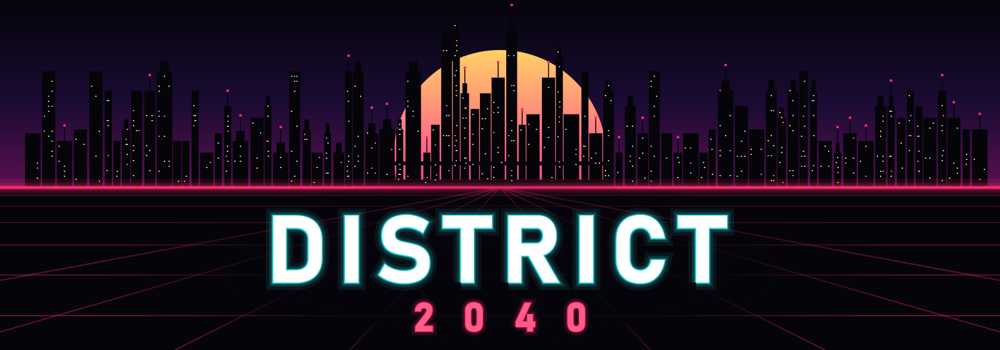
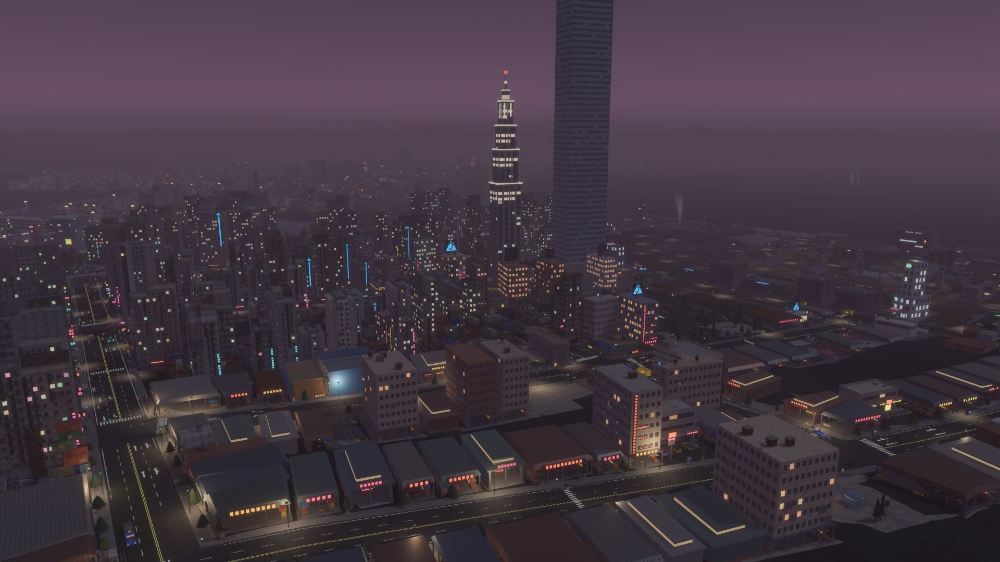
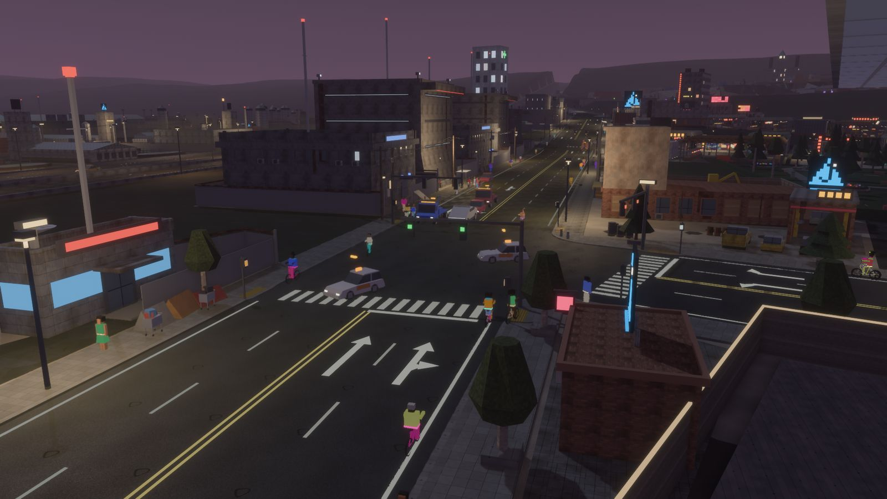
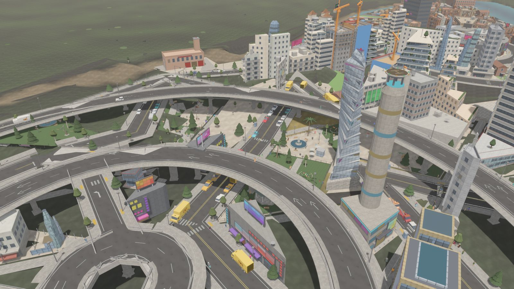
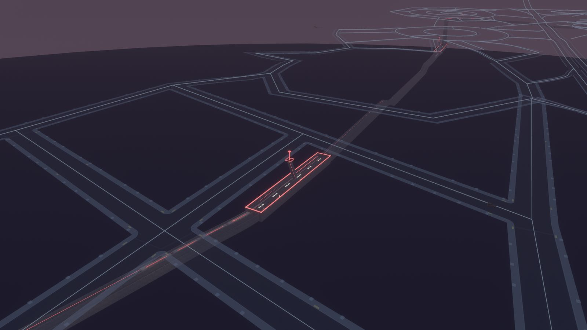
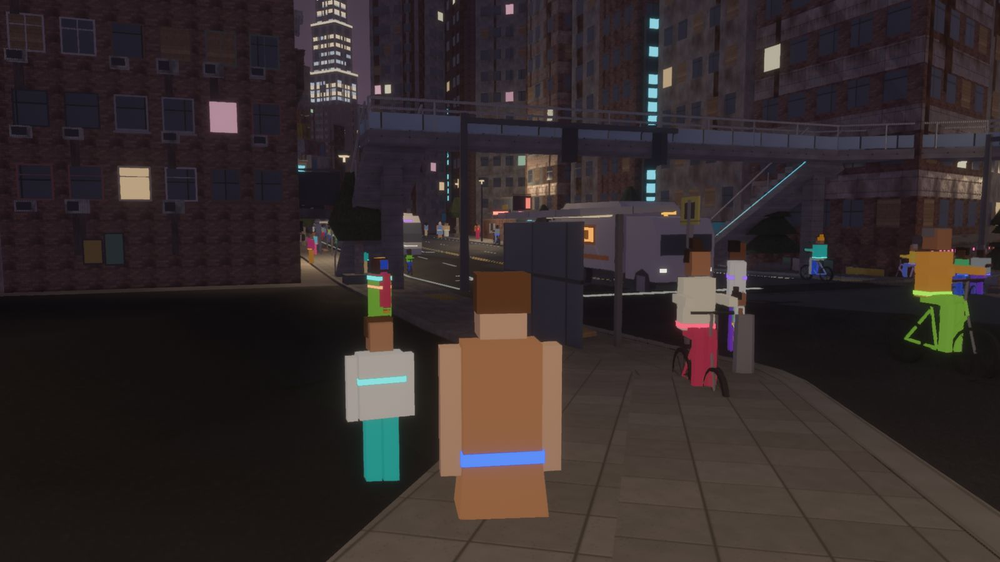
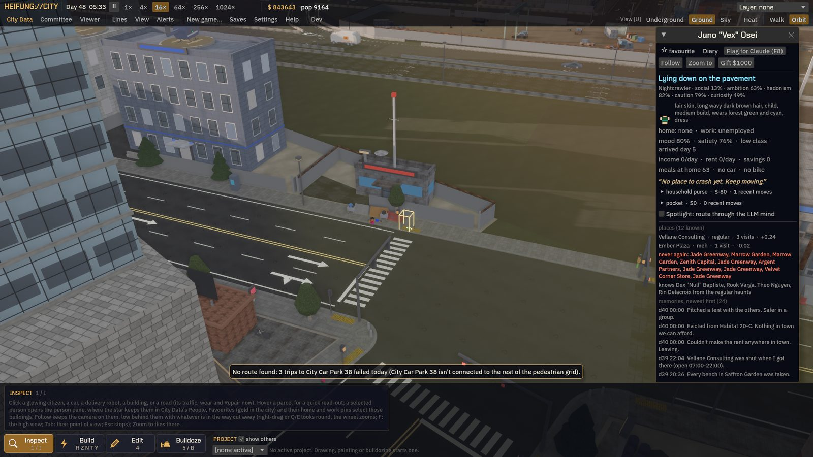
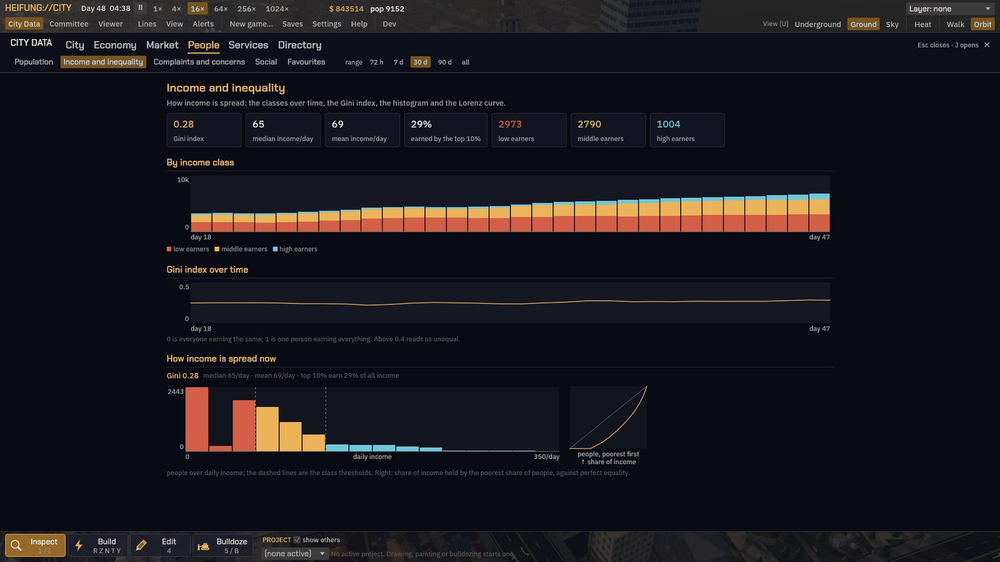
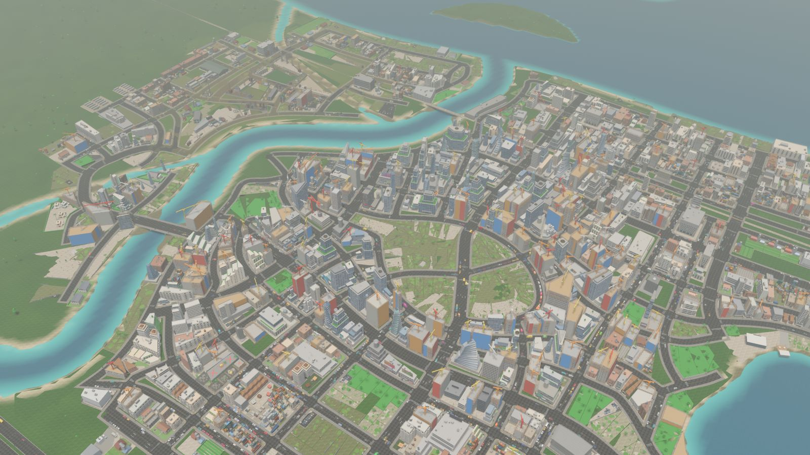
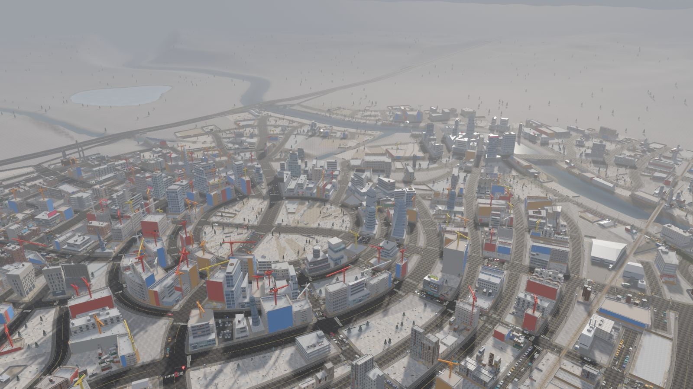

<p align="center">
  
</p>

<h1 align="center">HEIFUNG://CITY</h1>

<p align="center">
  <b>A near-future city builder where every street, tower and citizen is generated.</b><br>
  Open source. Rust, Bevy 0.19, egui.<br>
  <a href="https://harveymoon.github.io/HEIFUNG-CITY/">Project page</a> ·
  <a href="https://github.com/harveymoon/HEIFUNG-CITY/releases">Releases</a> ·
  <a href="#build-and-run">Build from source</a>
</p>



Draw the roads, zone the land and watch a city of thousands move in. Each citizen has a home, a
job, a commute and a mood; each shop has stock, cash and suppliers; each car follows its lane
through junctions you can tune by hand. Nothing in the game is a hand-made model: the terrain, the
220-odd building styles, the signs, the names and the people all come out of code, so no two
cities look the same.

The simulation is engine-independent and deterministic (same seed, same inputs, same city); the
renderer is a thin layer on top.

## Screenshots

| | |
| --- | --- |
|  |  |
|  |  |
|  |  |
|  |  |

More on the [project page](https://harveymoon.github.io/HEIFUNG-CITY/), all taken in the game.

## Features

### Roads and traffic
- **Lane-level traffic**: every car is simulated in its lane, follows the car ahead (IDM), changes
  lanes in a smooth glide, zip-merges, and routes over the whole lane graph.
- **Signals** with actuated phases and protected left arrows; lane arrows set from turning counts or
  by hand.
- **Junction editor**: per-phase green times, banned turns, lane arrows, and crosswalks upgraded to
  push-button signals or **footbridges** with stairs.
- **Roundabouts** of one to three lanes, 24 to 240 m across, with give-way entries and a middle you
  can zone; rings can nest.
- **Raised and sunken roads**: 2 m steps from −20 m to +24 m. **Viaducts** on pillars that can span
  over lots, **bored tunnels** with portals and vent heads, cuttings with retaining walls, automatic
  underpasses.
- **Curved roads**, lane presets from a footpath to a highway, one-ways, **highways** with ramps that
  merge without lights and a diamond **interchange** preset; bridges over water.
- **Planning in projects**: everything you draw is a hologram in a named project with its own undo;
  several projects can be planned side by side, then implemented.
- Toll booths priced per lane, road wear and budgets, road rage, street races, moto packs and
  warehouse raves after dark.

### People on foot, bikes and parking
- A **walking network** along pavements, footpaths, gates and alleys between lots; shops sell to
  the footfall that passes.
- Zebra crossings, waits at the lights, jaywalkers and near misses; bikes and cars owned by class.
- **Parking**: kerb spaces with a two-hour limit and residents' permits, car parks that open where
  drivers circle, parking wardens, tickets, clamps and **tow trucks**.

### Transit
- **Buses** on loops of kerbside stops, from depots, 05:30 to 23:30.
- **Metro** drawn station to station, looping lines, trains every 10 minutes by default, and an
  **Underground view**.
- **Rail**: a trunk line, branches you lay, stations, freight yards whose wagons really carry the
  goods, level crossings, and one Central Station per city.
- **Ferries** to towns off the map, freighters up the rivers, shipping ports, fishing fleets,
  marinas, beaches and private jetties.
- **Air**: drone pads, vertiports and skyports for eVTOL **air taxis**, air ambulances and a police
  helicopter.
- **Taxis** run by companies residents found when the demand is there.

### Economy and land
- Fourteen resources and recipe-driven **businesses** with stock, cash and floating prices; supply
  chains such as grain → livestock → meat; trucks deliver the deals, imports and exports fill gaps.
- Industry sub-zones (farming, oil, refining, ...) and dirty industry that contaminates the ground.
- **Land value** on a 32 m grid, three tiers of homes, **rent**, wages, classes, displacement and an
  inequality chart with a Lorenz curve.
- A **land market**: towers rise with demand (2 to 40 floors and a skyline league of skyscrapers,
  supertalls and megatalls), developers buy out low buildings, firms expand next door.
- Up to four fictional **mega-corps** with logos and HQ towers; universities; taxes per line, an
  import duty and an itemised **ledger**.
- **Billionaires and mansions**: when the city gets unequal enough, fictional billionaires arrive,
  buy two to four plots for a mansion in the local style, and drive in convoys with escorts.
- **Tourism**: hotels, a tourist tax, visitors by road, rail, ferry and air, ten landmark
  attractions.

### Districts and looks
- Paint **districts** with a brush or polygon, give each one of twelve **stories** (Lantern Lanes,
  Foundry Row, The Promenade, Quiet Acres, Eco Village, Riverbank Shantytown, ...) and its
  **policies** (rent support, nightlife levy, heritage grant, ...).
- Each story grows its own **procedural look**: Kowloon stacks, Brick & Steel, Lantern Alley,
  Garden Suburb, Harbour Pastel, Old Stone, Solarpunk Green, Glass Campus, Patchwork, plus neon
  strips, night markets, capsule pods, tech campuses and more: 16 looks over some 220 styles.

### Citizens and minds
- Every citizen has a generated look, a schedule, hunger, a **memory stream**, **moods** and
  concerns, and a book of favourite places and places they never go back to.
- **Social life**: friends, partners, rivals and enemies; bands, clubs, street-art crews and
  start-ups that put on gigs, paint murals, open businesses, petition and protest. Speech bubbles
  in the street.
- **Minds are pluggable**: a fast rule-based mind for everyone; optional LLM voices write lines and
  diaries for spotlighted citizens. The simulation never waits on a model.
- **The mayor's committee**: six advisers from a pool of fourteen watch the numbers, call meetings,
  argue proposals and vote, and you approve or veto. Runs **fully offline with no API key** (a
  seeded stand-in); optionally a local OpenAI-compatible server or the Claude API.
- Crime, homelessness, camps and RVs, trash.

### Services, power and emergencies
- **Power**: coal, solar, wind, nuclear, hydro with a dam, tidal and geothermal plants; batteries on
  time-of-use prices; brownouts that hit cheap districts first; smog, CO2 and noise.
- **Services** in three tiers: police, fire, health, schools, 911 dispatch, jails, trash depots,
  parking enforcement, monuments, stadiums.
- **Emergencies**: fires that spread, crimes and illness; a dispatcher sends the nearest unit with
  lights and sirens, police chases, fire engines working the scene, help from out of town (billed)
  when you have none.

### The world
- **Landscapes**: river valley, islands, coast, delta, plains or flat, with levers for water,
  relief, river branching and islands, and a mini-map.
- **Climates**: temperate, desert, tropical, arctic and volcanic; hourly cloud, wind and
  temperature, heat waves, cold snaps and storms; **rain and snow**; a full **day and night** with
  bloom and window lights that follow who is home.
- **City generator**: a whole city in seconds (`grid_plaza`, `coastal_river`, `old_town`,
  `twin_centres`, `perfect_city`), streets traced through tensor fields after Chen et al. 2008.

### Seeing it
- Orbit camera, **walk mode** at street level, a **chase camera** behind anyone or anything, their
  **point of view**, drone **heat vision**, the Underground view, map layers (land value, traffic,
  pollution, land survey, ...).
- **City Data**: one full-screen view of every report, chart and directory.
- **Building viewer**: a turntable for every building in the city and every style in the
  catalogue, day or night.
- **Photo mode** (`F10`): hides the UI for clean screenshots.

### Built to be tinkered with
- **Remote API**: a local JSON API (127.0.0.1:4817) with more than a hundred commands to build,
  inspect, move the camera and take screenshots; [`tools/mcp/nd_mcp.py`](tools/mcp/README.md) wraps
  it as an MCP server for AI assistants. See [`docs/REMOTE.md`](docs/REMOTE.md).
- **Hot-reloading data**: `assets/palette.ron` (every world colour; glow above 1.0 blooms) and
  `assets/rules/buildings.ron` (the building grammar and style table) reload while the game runs.
- **Saves** as compressed RON snapshots with a picture, grouped by game on the title screen, with
  daily autosaves kept as history you can revert to.
- **Playtest flags**: `F8` bookmarks whatever is selected with a note and a snapshot of its state,
  so whoever fixes it sees exactly what was meant.
- **Headless**: the simulation runs in tests, probes and a terminal with no window.

## Build and run

Requirements: Windows 10 or 11, a GPU with Vulkan or DirectX 12, and stable Rust from
[rustup.rs](https://rustup.rs) (MSVC toolchain). The first build compiles Bevy and takes several
minutes.

```
git clone https://github.com/harveymoon/HEIFUNG-CITY
cd HEIFUNG-CITY
cargo build -p nd_app --release
target\release\heifung_city.exe
```

Or simply `cargo run --release -p nd_app`. Saves go to a `saves` folder next to the exe.

Other useful commands:

```
cargo run --example headless -p nd_sim -- 3    # simulate a small city for 3 days in the terminal
cargo test --profile fast --workspace          # the tests
cargo run -p nd_app --features fast-dev        # links Bevy dynamically for quicker iteration
```

## Controls

| Keys | Does |
| --- | --- |
| Right-drag, middle-drag or Shift-drag, wheel | rotate, pan, zoom |
| `W A S D`, `Q` `E` | pan, turn |
| `1`–`9` | tools: inspect, roads, zones, edit, bulldoze, buildings, buses, rail, ... |
| `Ctrl+Enter`, `Ctrl+Z`, `Ctrl+Y` | implement the project, undo, redo |
| `Space`, `-`, `=` | pause, slower, faster (1× to 1024×) |
| `Tab` | walk the street (Esc returns) |
| `J`, `X` | City Data, building viewer |
| `U`, `H`, `V`, `P` | underground view, heat vision, land value, pedestrian network |
| `F5`–`F12` | camera jumps (station, busiest junction, a building per tier, plant, park); `F8` flag a note, `F10` photo mode |

The in-game Help window lists everything.

## Layout

| Crate | What |
| --- | --- |
| `nd_sim` | the deterministic simulation: roads, traffic, zoning, lots, buildings, citizens, economy, transit, services, save/load. No engine. |
| `nd_procgen` | terrain, parcels, the city generator, every building style and its parts, textures, palette |
| `nd_minds` | the rule-based and hybrid minds, the committee and the LLM backends |
| `nd_app` | the Bevy front end: rendering, camera, tools, egui UI, the remote API, hot reload |

Design notes live in [`docs/DESIGN.md`](docs/DESIGN.md), the art direction in
[`docs/STYLE_REFERENCE.md`](docs/STYLE_REFERENCE.md), the committee in
[`docs/AI_COMMITTEE.md`](docs/AI_COMMITTEE.md), and the work list in [`todo.md`](todo.md).

## Roadmap

A big world with seamless edges and in the end a planet; timetables with night trains and rush-hour
service; islands reached only by ferry; a layered city with life under and between raised roads;
full metro stations and an undercity; the Skyline Luxe look; a drive mode; talking to any citizen;
cable cars and a monorail; a weekly city paper. See [`todo.md`](todo.md).

## Contributing

Issues and pull requests are welcome. Please keep the simulation deterministic (no new unseeded
randomness, no hash-map iteration order in the sim), keep old saves loading, and run the test suite
before sending a change. Everything visual is generated in code: please don't add third-party
images, models or textures.

## References and thanks

HEIFUNG://CITY began as a cyberpunk-themed fork of [Citybound](https://github.com/citybound/citybound),
Anselm Eickhoff's open-source city builder in Rust. That fork was a theme and a look; the game was
then started again from an empty repository on Bevy, and none of Citybound's code is in it. What
carried over were ideas: Rust for the simulation, a data-driven building grammar, roads drawn as
polylines and zones as polygons, several planned projects side by side, and a window that can
inspect anything. Thank you, Anselm.

Other inspirations:
- **Cities: Skylines**: the road tool, districts and policies, the metro, rail pieces, park paths.
- **SimCity**: zoning, demand for homes, shops and industry, a treasury that has to balance.
- **Kowloon Walled City** and the tenements, pencil towers and streets of **Hong Kong**.
- **Akira** and **Ghost in the Shell**: megastructures, glass terraces, one long low red bike.
- Chen, Esch, Wonka, Müller and Zhang, *Interactive Procedural Street Modeling* (2008), the method
  the street generator follows (as ProbableTrain's MapGenerator does).
- Park et al., *Generative Agents* (2023), the model for each citizen's memory stream.
- [Bevy](https://bevyengine.org), [egui](https://github.com/emilk/egui) and the Rust ecosystem.

Reference pictures were used for style only and are not part of the repository; nothing is traced,
copied or imported.

## Licences

The code is dual-licensed under [MIT](LICENSE-MIT) or [Apache-2.0](LICENSE-APACHE), at your option.

The fonts in `assets/fonts` (Chakra Petch, IBM Plex Sans, IBM Plex Mono, Noto Sans Symbols 2) are
under the SIL Open Font License 1.1; their licence files sit beside them. All Rust dependencies are
under permissive licences (MIT, Apache-2.0, BSD, Zlib, ISC, Unicode and similar).

All people, companies and billionaires in the game are fictional.
