# Road structures: visual QA, 2026-10-07 (fix/road-polish)

Harvey asked for a walk round the roads looking for anything strange and unnatural, with a
close look at junctions, underpasses, overpasses, ramps and bridges.

## How the survey was done

- **In game**: a test instance (port 4895, High quality; walk views on Medium, see #33) driven
  through the remote API. Three example cities: grid_plaza 1, old_town 3 and coastal_river 2
  (each grown 3 to 6 days). A test scene on the flat map with one of each: crossroads of an avenue
  and a street, a T, five arms, forks at 25 and 11 degrees, a roundabout, a curve, a street
  viaduct over a street, a tunnel under a street, a footpath and a railway across a street, an
  avenue narrowing to a street, an off-ramp and an on-ramp with a street between them, a street
  under the highway. Hills, tunnel portals, a river bridge and a viaduct in a river_valley game
  (seed 5, relief 0.9). Orbit close (45 m) and top-down (110 m), walk at street level looking
  along the road, day (13:00) and night (22:30). Scripts: `tools/road_qa/` (`scene.py`,
  `shoot.py`, `walk.py`).
- **Offline**: `cargo run --profile fast -p nd_procgen --example street_scene -- scene out.json`
  draws the same scene (or `<preset> <seed> out.json x,y ...` for spots of a generated city) with
  the street generator and `tools/road_qa/render.py` renders it top-down, so a change can be
  checked without the game. `--example road_qa_probe` counts artifacts numerically over four
  example cities (lane markings inside junctions, props and kerbs on lanes, terrain over roads).
- Screenshots are under `screenshots/qa/` in the worktree (not committed): `b*` taken with
  main, `a*` with this branch, same camera. Before/after pairs below are in
  `docs/qa/road_artifacts_2026-10-07/`.

Probe, before and after (four example cities):

| | grid_plaza 1 | coastal_river 2 | old_town 3 | twin_centres 4 |
| --- | --- | --- | --- | --- |
| junctions with lane markings inside | 221 → 0 | 209 → 0 | 233 → 0 | 234 → 0 |
| kerb tops over a street's lanes | 3 → 2 | 9 → 7 | 2 → 2 | 6 → 6 |

(The remaining kerb hits are single kerb vertices where a kerb joins straight across a slight
kink between two arms or ends where an arm meets a ring or a ramp, within a few centimetres of the
probe's margin; one is new in old_town at (-440, 339), a straight join across a kink, not looked
into further. "Props on lanes" is dominated by signal arms on sloping approaches, #34.)

## Artifacts

Status: **fixed** (with the commit), **partly**, or **not fixed** with why. Coordinates are sim
metres; "scene" means the flat-map test scene.

### Junctions (seen at nearly every junction in ordinary play)

1. **Lane lines of every arm run across the junction** (edge, centre and lane lines of all arms
   make a grid in the box). grid_plaza (320, -307) orbit and walk; every junction of every city
   (probe: 221 junctions in grid_plaza). **Fixed**: each arm's markings stop at its stop line
   (`street_junction.rs`, `Mouth::marks`). Pairs `01_crossroads_lines`, `01b_crossroads_night`,
   `02_five_arms`. Test `lane_markings_stop_at_the_junctions`.
2. **The round junction pad bulges off the road**: a dark half disc past every dead end, between
   arms with no kerbed corner (where ramps meet a street, grid_plaza (-141, 361)), into a
   roundabout's island (scene (500, -550)), over the ground at a skew T (grid_plaza (-207, -59)).
   **Fixed**: each arm's carriageway stops at its mouth and the pad is the polygon through the
   mouths and the corners' kerb lines, each point at its road's height. Pairs `03_skew_T`,
   `04_ramps_meet_street`, `10_roundabout`. Test `junction_pads_stay_on_the_roads`.
3. **The pad is a disc of a different asphalt** on cheap streets (clean pad, worn streets).
   **Fixed**: worn like the junction's corners.
4. **Coplanar asphalt flickers where two arms meet at a sharp angle** (both strips reached the
   node at the same height and overlap for tens of metres at a fork). scene forks (200, -550) and
   (620, -250). **Fixed** (strips start at the mouth). Test `no_coplanar_asphalt_at_forks`.
5. **Zebras painted metres from the curb cut** at sharp corners (paint at the junction radius,
   walk graph and kerb drop at `crosswalk_setback`); **two arms' zebras overlapping**.
   grid_plaza (-207, -59), scene (200, -550). **Fixed**: painted at the set-back; at a sharp
   corner nd_sim puts the zebra past the rounded kerb (`acute_setback`), not half on it.
6. **Zebras painted across ramps and other arms nobody crosses** (no walk-graph crosswalk, no
   kerb drop), and walk lights on them. grid_plaza (-141, 361). **Fixed**.
7. **Sharp forks: no corner, so one arm's kerb and pavement run across the other's lanes**; a
   paving slab across an avenue at grid_plaza (-207, -59); kerbs over lanes and jumbled zebras at
   the scene's 25 and 11 degree forks. **Fixed**: corners fitted further out with a tight nose
   (`CORNER_TANGENT_MAX`), a corner may take half a short block, a side with no corner keeps its
   kerb back until clear of its neighbours (`kerb_clearance`). Pairs `07_skew_corner`,
   `11_fork_25deg`, `12_fork_11deg_dead_end`, `20_walk_fork`.
8. **Signal and walk-light poles in a neighbour's lanes or in the middle of a junction**
   (grid_plaza five-way at (-47, -125)). **Fixed**: moved off every arm and off the junction's
   surface onto the pavement (`place_pole`); at a sharp fork the signal stands at the painted
   stop line. Pair `06_five_arm_poles`. Test `no_furniture_on_the_lanes`.
9. **Lamps, trees, bins and utility poles on another street's lanes**, and a lamp on the wedge
   of asphalt of a fork before its pavement begins (scene (200, -550)). **Fixed**: furniture only
   where its own side is kerbed and off every carriageway; walk-view clutter likewise.
10. **Lane arrows painted over the zebra of the junction behind** on short blocks (grid_plaza
    (-141, 361)), and **inside the junction** at a fork. **Fixed**: arrows stand 4 m before the
    drawn stop line and clear of every zebra. Test `lane_arrows_keep_off_the_crosswalks`.
11. **Lane arrows lifted onto the nearest road per vertex** (a deck overhead could take part of
    an arrow up with it). Code review; **fixed**: drawn at their own road's height
    (`lane_arrows` takes the heights; `lift_spawned` no longer lifts them).
12. **Small slivers of bare ground** between a corner's apron and the pad on curved streets.
    **Fixed** (the pad takes the corner's own point). A few remain at noses of very sharp corners
    in generated cities (a metre or two); **partly**.
13. **Dead ends: a half disc of asphalt past the end, pavements open-ended**. scene (600, -250),
    the overpass's west end. **Fixed**: kerbed round the end (`cul_de_sac`). Pair
    `17_dead_end`. Test `a_dead_end_is_kerbed_round`.
14. **Lane drop on a town street steps the kerb straight across at the joint** (avenue to
    street, scene (350, -250)). **Fixed**: the kerb comes in over a taper with the asphalt filled
    out to it. Pair `16_lane_drop_taper`. Test `a_narrowing_street_tapers_its_kerb`.
15. **Roundabout ring drawn as an octagon**: faceted outer pavement, inner edge cutting into the
    island (scene (500, -550)). **Fixed**: the ring follows its circle. Pair `10_roundabout`.

### Ramps and the highway

16. **Ramp edge lines cross the highway's lanes in an X** at every diverge and merge (the ramp
    is drawn from its node on the highway's centre line; the gore's "back" line likewise), with a
    pale parallelogram of asphalt over the lanes. scene (280, 405) and (-170, 405), every
    interchange in the example cities. **Fixed**: the ramp's strip and lines begin where it is
    clear of the carriageway; before that its lane widens out from the carriageway's edge, then
    the hatched gore. Pairs `08_offramp`, `09_onramp`.
17. **Gore drawn in clean asphalt on a worn highway** (pale patch). **Fixed**.
18. **Two lamps side by side at the gore's nose** (the ramp's lamp stood on the highway's
    shoulder). **Fixed** (furniture off other carriageways).
19. **Highway over a street: the underpass deck's parapet stood inside the highway's own
    barrier** and its rail floated 0.2 m over the barrier (doubled, striped barriers). scene
    (-400, 420). **Fixed**: no parapet on a motorway's deck, the rail on the barrier. Pair
    `19_underpass_parapets`.
20. **Ramp meeting a street at a bend**: the ramp's barrier ends over the street's pavement.
    scene (150, 250). **Not fixed**: small; the barrier would need to stop at the corner's kerb.

### Rail and paths

21. **The trunk line floats a metre over streets** with no level crossing and no bridge: a street
    vertex lying exactly on the track was not seen as a crossing, so the street passed under the
    track at grade. grid_plaza (-526, -480), (0, -480), (166, -480); every example city.
    **Fixed** in `nd_sim::roads` (it now makes a level crossing). Pair `05_rail_over_street`. Test
    `a_street_vertex_on_the_track_makes_a_level_crossing`.
22. **Level crossing: ballast, sleepers and rails stand 0.3 m proud of the road and over the
    kerbs; planks float 0.15 m over the asphalt and out over the pavements.** scene (100, -55).
    **Fixed**: the track stops at the back of the pavements; the crossing is a flush panel with
    the rails laid in, rails across the pavements at their height. Pair `13_level_crossing`. Test
    `a_level_crossing_lies_flush`.
23. **A footpath crossing a street drew its paving across the carriageway.** scene (100, -150).
    **Fixed**: paths and tracks end at a street they cross. Pair `14_path_crossing`.

### Bridges, viaducts, tunnels

24. **Bridge parapet rail down the middle of the pavement** (the deck was half a pavement
    narrower than the road). old_town (-263, 159), coastal_river (-493, -170). **Fixed**.
25. **Tunnel vent shaft head standing in the lanes of the street over the bore.** scene
    (-150, -100). **Fixed**. Pair `15_vent_on_street`.
26. **Wooden utility poles and their wires on viaduct and bridge decks.** scene (-450, -100).
    **Fixed**: they stand in the ground. Pair `18_overpass_poles`.
27. **Bridge deck ends show as concrete blocks on the bank** (no abutment, the deck slab simply
    stops). coastal_river (-493, -170) low view. **Fixed** [fix/interchange]: a bank seat under the deck's end and
    stepped wing walls back into the embankment (`terrain::abutment`). Pair
    `interchange_2026-10-08/05_bridge_abutment`.
28. **A ramp's gore on a highway bridge is a thin asphalt sheet over the water** with no deck
    under it, seen from below. coastal_river (-452, 411). **Partly** [fix/interchange]: where a ramp's
    own bridge piece leaves a highway bridge node, deck now fills under the gore between the two
    (`terrain::waterworks`); at this spot the gore itself lies on the bank, so it looks the same.
29. **Cutting walls of a tunnel ramp stand about 3.4 m behind the pavement** with a strip of
    earth between (river_valley (60, -500)). Reads as a cutting; **not changed** (the offset
    hides the terrain grid's slope; `tunnel_works`).
30. **Flat map: roads below the ground disappear under it** (a tunnel's portal ramp, the start of
    a road drawn from 0 to -8 m). scene (-260, -100). **Not fixed, by design**: the flat map's
    ground has no raster (`Ground::build`: "a way below it runs out of sight"). Suggest building
    the raster on the flat map once relief is on.
31. **A road pulled below grade at its end**: the scene's tunnel road, drawn from level 0, starts
    3.1 m down (the 7% grade cannot climb from -8 m in 70 m), in a pit on a landscape, under the
    ground on the flat map. **Not fixed**: nd_sim road heights; the road tool already warns
    "too steep".
32. **Mid-block zebra on a viaduct deck**, over the street below. Walkable (the deck has
    pavements); **not changed**.

### Not road geometry

33. **High graphics tier: everything near the camera washes out to white** in walk view and in
    low orbit views close to the ground (both with this branch and main). Looks like the
    volumetric haze near the camera (`render/haze.rs`, `look.rs`). **Not fixed**: renderer, not
    road geometry; worth its own look. Medium is fine.
34. **Signal arms on a steep approach hang low** (3.2 to 3.5 m over the lanes): the post is set
    at the junction's height and the road rises beside it. **Fixed** [fix/interchange]: the pole
    grows and the arm and heads rise by how far the road under the heads stands above the
    junction. Pair `interchange_2026-10-08/06_signal_arm_slope`.
35. **At a sharp fork the painted stop line is beyond the crosswalk set-back while cars stop at
    the junction's radius** (nd_sim lanes end there), metres inside it. Signals moved to the
    painted line. **Fixed** [fix/interchange]: an arm's lanes end `walk::stop_back` further out
    (`LaneNetwork::stop_back`), 4 m in from the painted line as at any junction; arrows and signals
    follow. Test `cars_stop_at_a_sharp_forks_painted_line`.
36. **Busy junctions of near-parallel arms** (coastal_river (-353, -456)): much better (no lines
    through, corners fitted) but still two zebras side by side and a wide asphalt area. **Partly.**

## Tests

New in `crates/nd_procgen/src/street_junction.rs`: `lane_markings_stop_at_the_junctions`,
`junction_pads_stay_on_the_roads`, `no_coplanar_asphalt_at_forks`, `no_furniture_on_the_lanes`,
`a_dead_end_is_kerbed_round`, `lane_arrows_keep_off_the_crosswalks`, `a_level_crossing_lies_flush`,
`a_narrowing_street_tapers_its_kerb`. In `crates/nd_sim/src/roads.rs`:
`a_street_vertex_on_the_track_makes_a_level_crossing`. Existing kerb, corner, ramp and preview
tests pass unchanged. `cargo test --profile fast --workspace --no-fail-fast -j 6`: all pass.

## Pairs

| | |
| --- | --- |
| 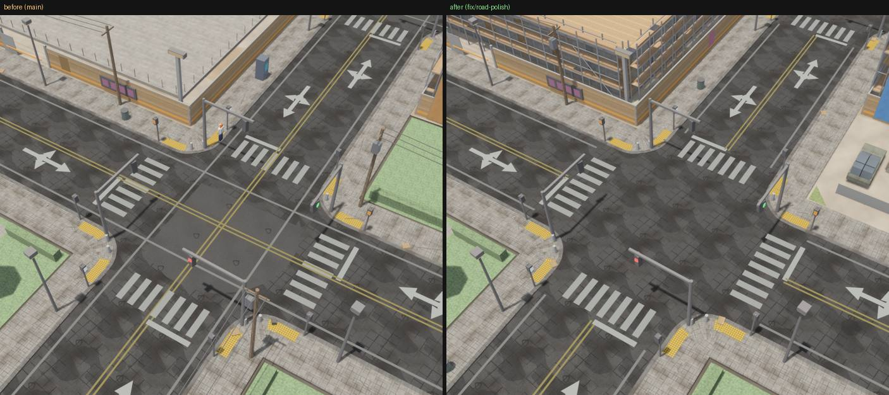 | lane lines through the crossroads (grid_plaza, orbit) |
| 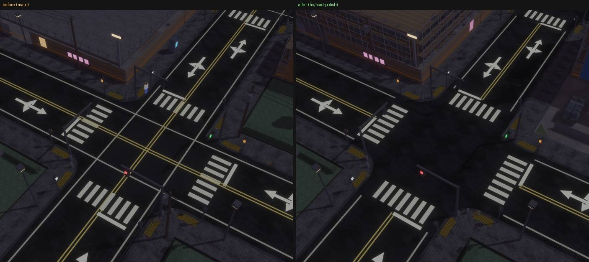 | the same at night |
| 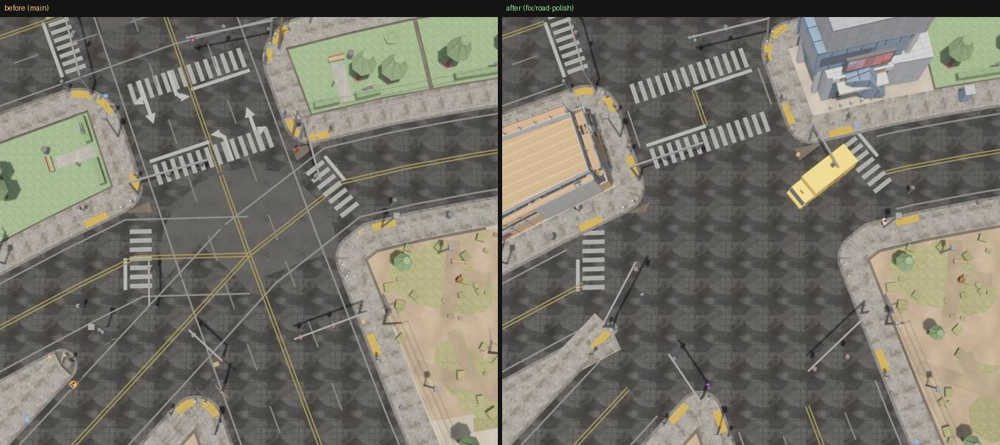 | five-way junction (grid_plaza, top) |
| 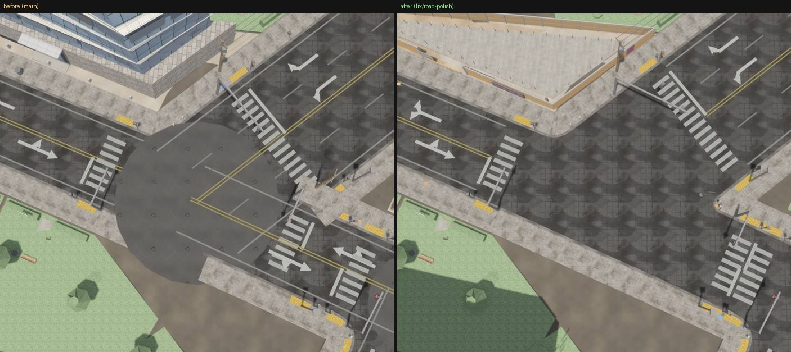 | skew T: pad disc, paving over the avenue, zebras |
| 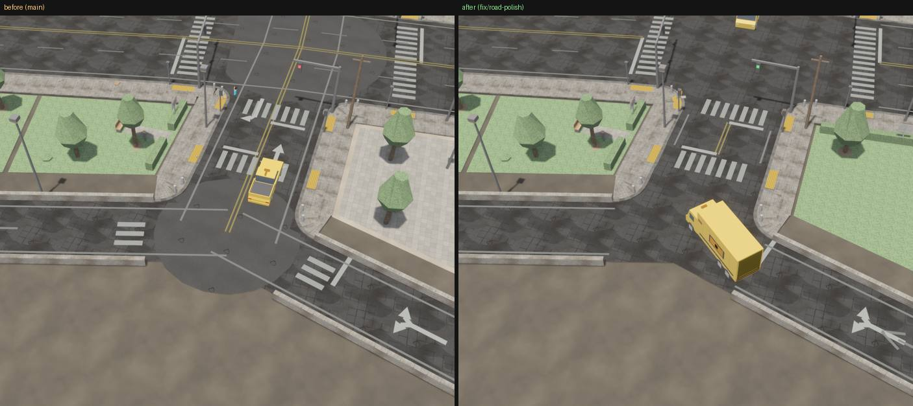 | ramps meeting a street: pad, X lines, arrows on the zebra |
| 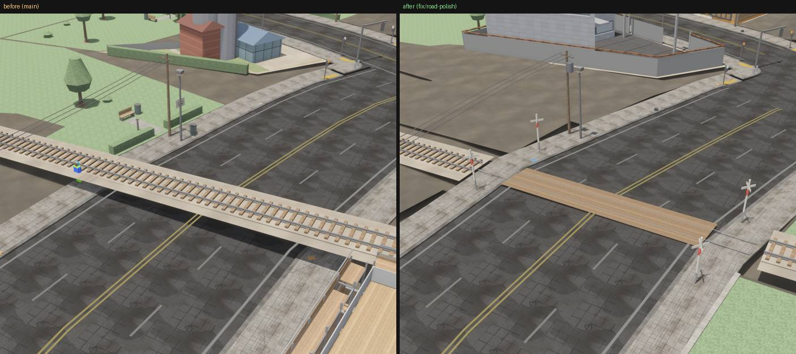 | trunk line over a street at grade |
| 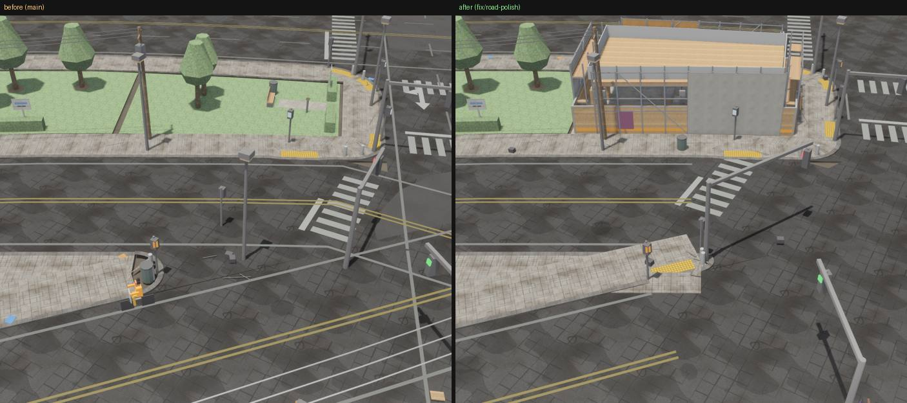 | five-way: poles in the junction |
| 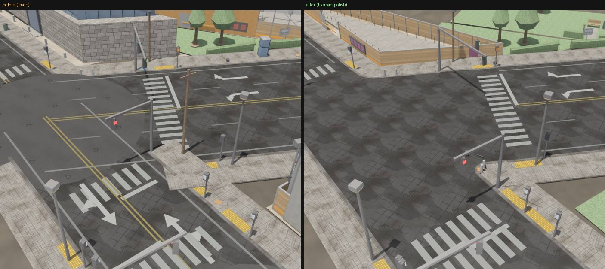 | skew corner: paving slab across the road |
| 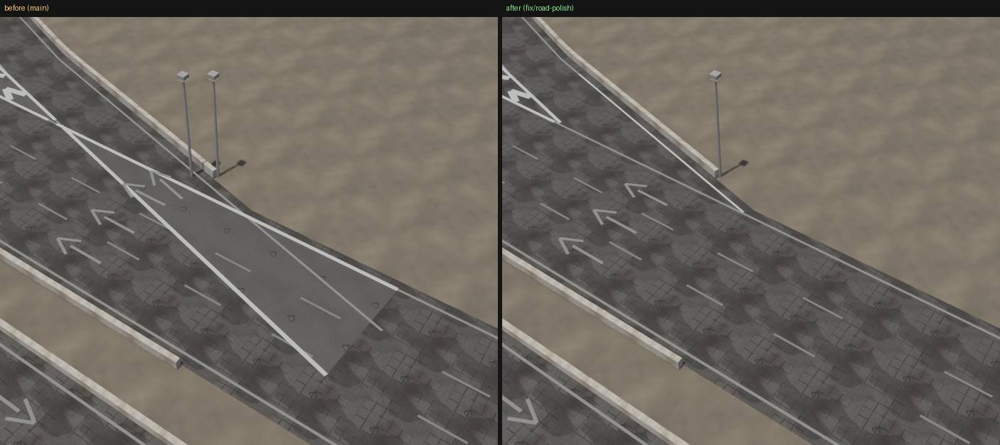 | off-ramp: X lines over the highway |
| 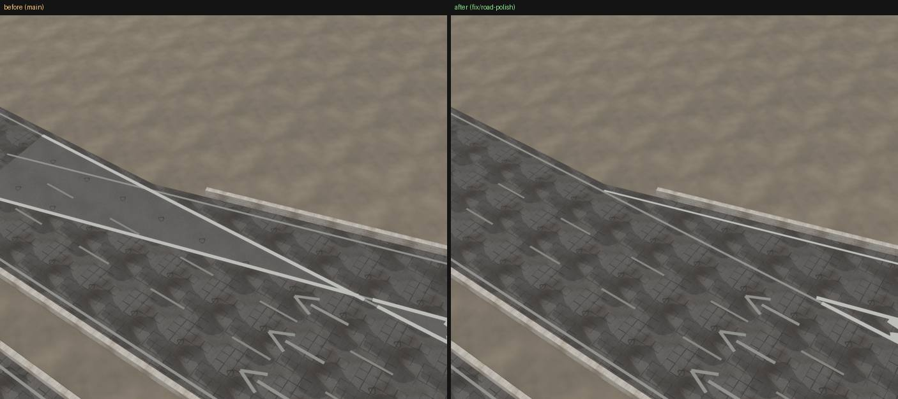 | on-ramp |
| 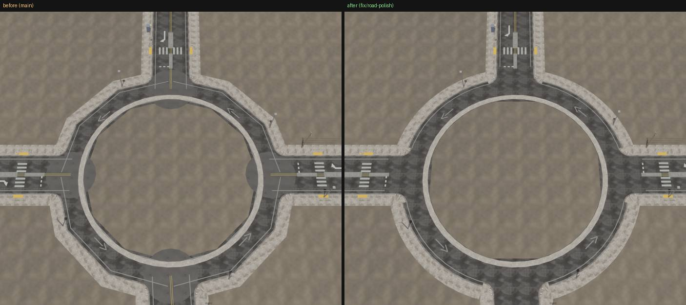 | roundabout: pads in the island, octagon |
| 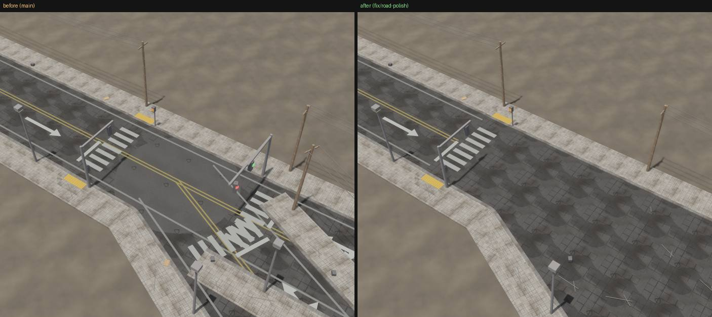 | fork at 25 degrees |
| 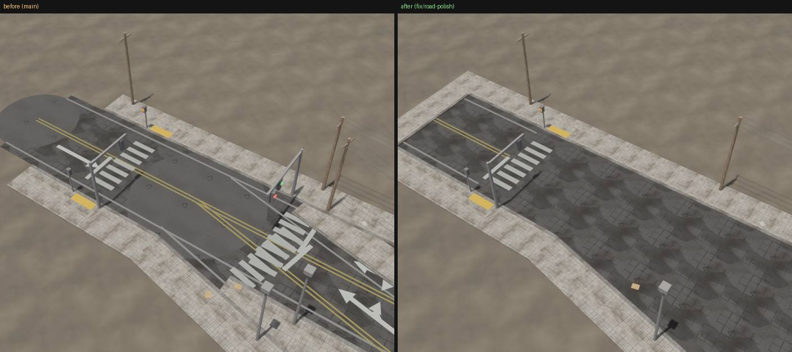 | fork at 11 degrees and a dead end |
| 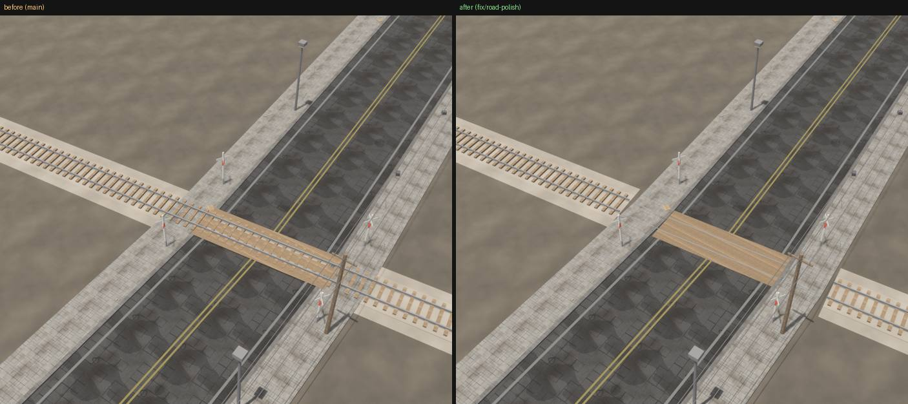 | level crossing |
| 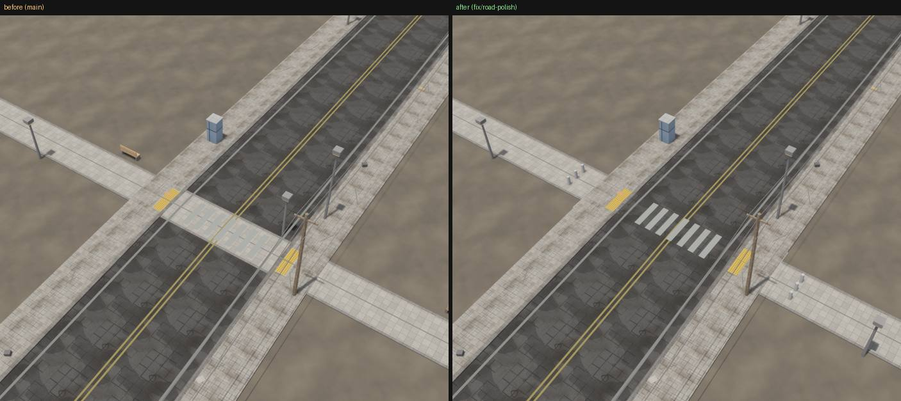 | footpath over a street |
| 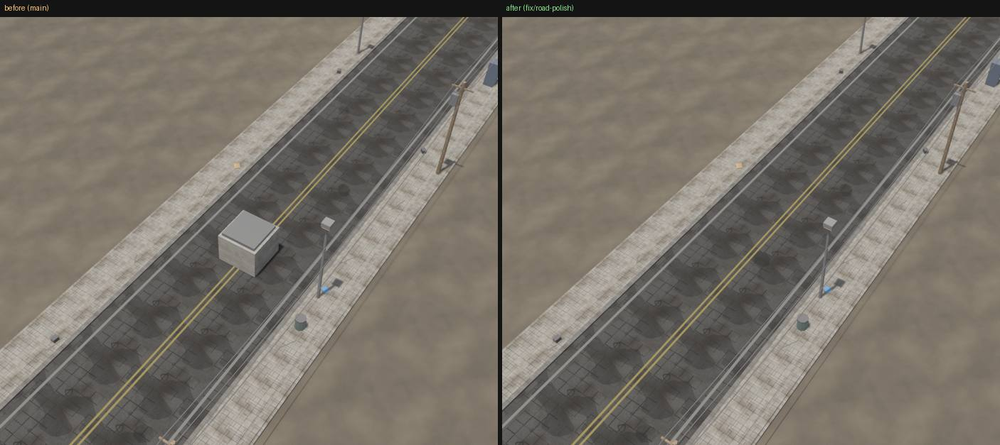 | tunnel vent on the street above |
| 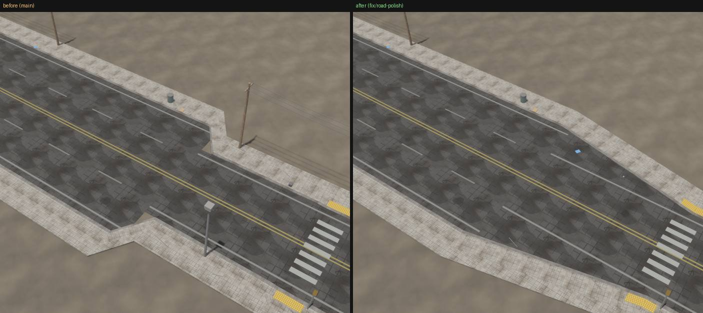 | avenue narrowing to a street |
| 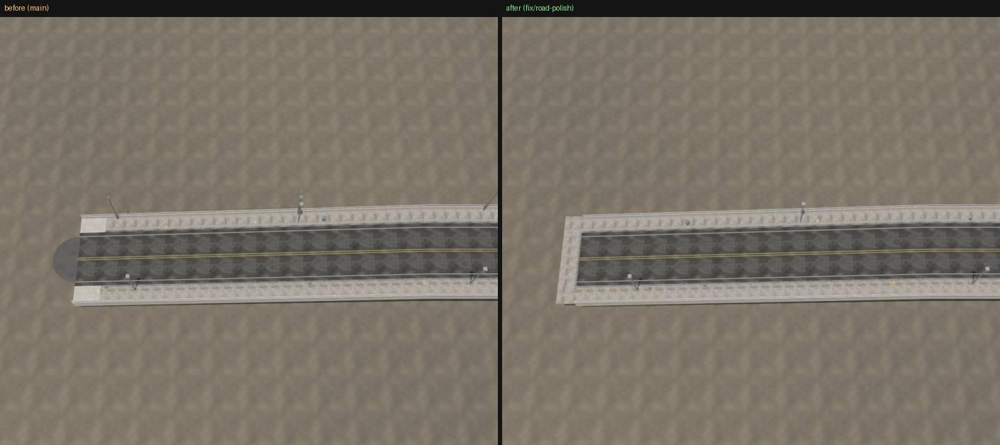 | dead end |
| 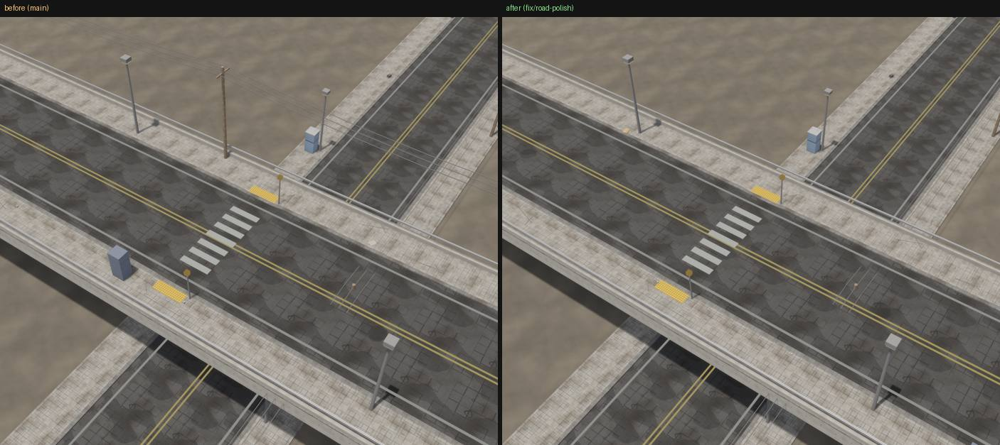 | utility poles on a viaduct |
| 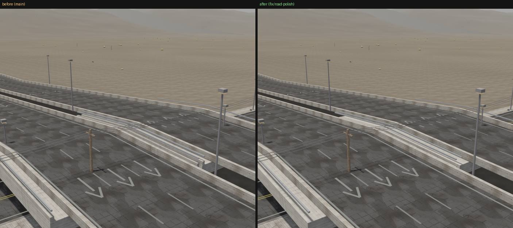 | highway over a street: doubled barriers |
| 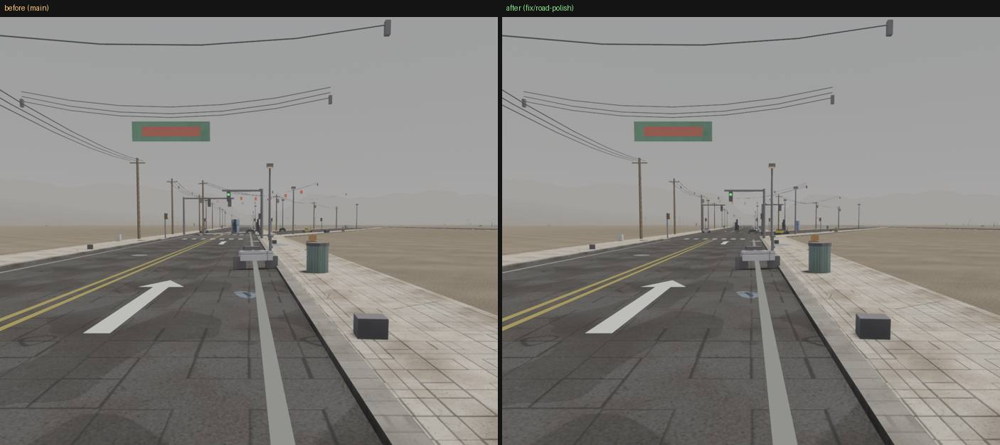 | walk view at the 25 degree fork |
| 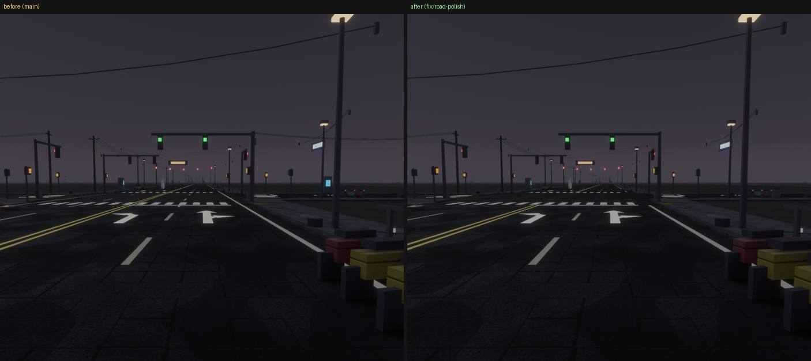 | walk view at the crossroads at night |
| 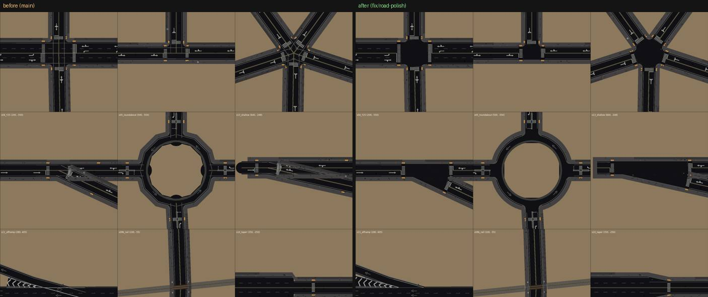 | the scene top-down (offline renderer) |
